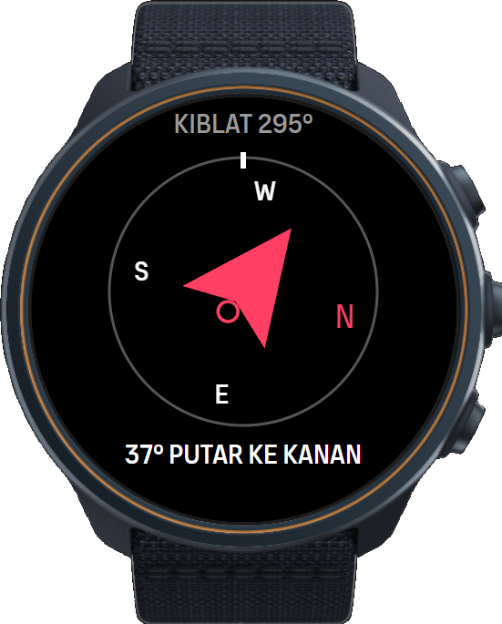
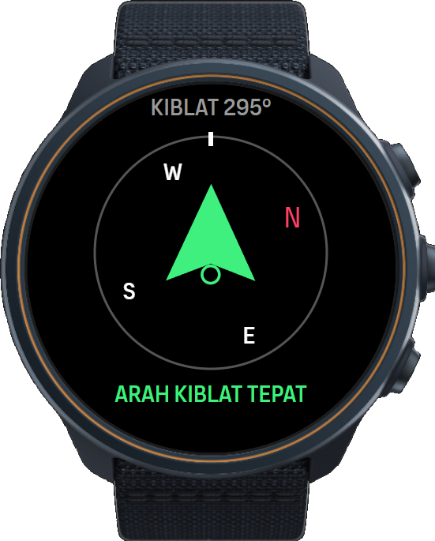
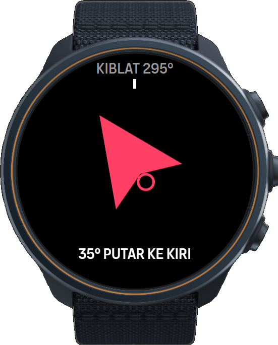
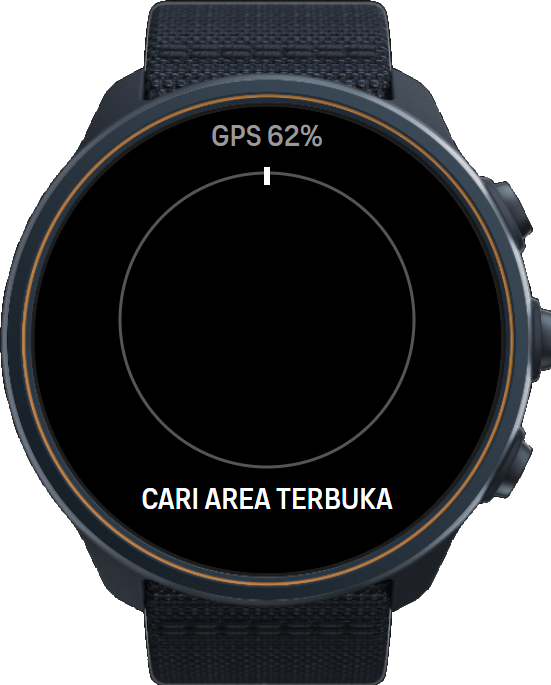
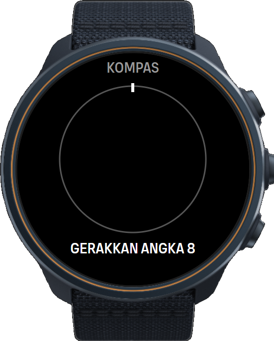

# Panduan Instalasi Qibla Compass — Suunto Race S

> **Disclaimer kompatibilitas.** Qibla Compass sudah diuji dan berjalan baik di **Suunto Race S**. Aplikasi ini **belum pernah dicoba di jam Suunto jenis lain** (Race, Vertical, 9 Peak Pro, Ocean, dan lainnya). SuuntoPlus Editor bisa membuat paket untuk ukuran layar lain, tetapi perilaku GPS, kompas, dan tampilannya di model tersebut belum terverifikasi. Pemakaian di model lain menjadi risiko pengguna.

## Batasan penting

### 1. Aplikasi hanya berjalan di dalam mode olahraga

Aplikasi SuuntoPlus hanya aktif selama sebuah mode olahraga (latihan) berjalan. Tidak ada versi watch face atau widget. Untuk mencari kiblat: mulai mode olahraga dengan Qibla Compass dipilih, baca arahnya, lalu hentikan. Aktivitas singkat itu boleh dihapus. Mode khusus bernama **Kiblat** memudahkan, tetapi mode olahraga apa pun bisa dipakai.

### 2. Menyambungkan jam ke HP membuat aplikasi terhapus (ter-reset)

Qibla Compass dipasang langsung dari komputer lewat SuuntoPlus Editor (pemasangan pengembang), **bukan** dari SuuntoPlus Store. **Begitu jam tersambung dan sinkron dengan aplikasi Suunto di HP, daftar aplikasi SuuntoPlus di jam dikembalikan sesuai akun Suunto Anda, sehingga Qibla Compass hilang dari jam.** Sinkron lewat SuuntoLink di komputer juga berakibat sama.

Artinya:

- Selesaikan semua yang butuh HP (membuat mode olahraga **Kiblat**, pengaturan, update firmware) **sebelum** memasang Qibla Compass.
- Setelah terpasang, biarkan jam **tidak berpasangan** dengan HP (atau matikan Bluetooth HP) selama ingin tetap memakai aplikasinya.
- Jika jam terlanjur sinkron dengan HP, pasang ulang aplikasi dari komputer (langkah 5).
- Batasan ini baru hilang setelah aplikasi terbit di SuuntoPlus Store.

### 3. Pemasangan hanya lewat Bluetooth, minimal Bluetooth 4.0 (BLE)

Kabel charger Race S **tidak membawa data**, jadi pemasangan hanya bisa lewat Bluetooth. Komputer harus mendukung **Bluetooth Low Energy (BLE), yaitu Bluetooth 4.0 atau lebih baru**.

| Bluetooth komputer | Bisa dipakai? |
|---|---|
| 2.0 / 2.1 / 3.0 (misalnya dongle lama CSR "BT 2.0") | ❌ Tidak. Tidak mendukung BLE, jam tidak akan terdeteksi |
| 4.0, 4.1, 4.2 | ✅ Bisa |
| 5.0 – 5.4 | ✅ Bisa. Sudah diuji dengan dongle USB **Bluetooth 5.4** |

Cara mengecek versi Bluetooth di Windows: **Device Manager → Bluetooth → adapter Anda → Properties → Advanced → Firmware / LMP**.
LMP 6 = 4.0 · 7 = 4.1 · 8 = 4.2 · 9 = 5.0 · 10 = 5.1 · 11 = 5.2 · 12 = 5.3 · 13 = 5.4. LMP 5 ke bawah terlalu lama.

## Yang dibutuhkan

- Komputer Windows 10/11 atau macOS
- Visual Studio Code
- Ekstensi resmi **SuuntoPlus Editor**
- Bluetooth komputer versi 4.0 atau lebih baru (bawaan laptop atau dongle USB)
- Jam Suunto Race S yang baterainya cukup

## Langkah pemasangan

### Langkah 1 — (Opsional) Buat mode olahraga di HP terlebih dahulu

Di aplikasi Suunto di HP, buat mode olahraga khusus bernama **Kiblat**, lalu sinkronkan ke jam. Lakukan sekarang, karena setelah ini HP harus diputus dari jam.

### Langkah 2 — Putuskan HP dari jam

Di jam: **Settings → Connectivity → Paired devices → MobileApp → Forget**.

### Langkah 3 — Pasang VS Code dan SuuntoPlus Editor, lalu buka folder proyek

1. Pasang Visual Studio Code dari https://code.visualstudio.com.
2. Buka panel Extensions (`Ctrl+Shift+X`), cari **SuuntoPlus Editor**, pasang ekstensi resmi dari Suunto.
3. **File → Open Folder…**, pilih folder proyek ini.
4. Tutup SuuntoLink bila sedang berjalan.

### Langkah 4 — Pasangkan jam ke komputer lewat Bluetooth (ikuti urutannya)

1. Hapus jam dari **Settings → Bluetooth & devices** di Windows bila sudah ada di daftar.
2. Di VS Code, klik **Refresh** **satu kali** pada panel **SUUNTO WATCH**.
3. Pasangkan jam di Windows (**Add a device**), setujui kode di jam bila diminta.
4. Jangan sentuh apa pun sampai muncul **Connected Suunto watch**. Jangan klik Refresh lagi selama proses menyambung.

### Langkah 5 — Build dan kirim ke jam

Di panel **SUUNTOPLUS APPS**, klik **Build and Add App to Watch**. Pilih bahasa **English (`en`)** sebagai default, atau **Bahasa Indonesia (`id`)** bila ingin tampilan berbahasa Indonesia. Editor otomatis memilih paket layar yang cocok untuk Race S.

### Langkah 6 — Jalankan di jam

Pilih mode **Kiblat** (atau mode lain), buka opsi sebelum mulai, masuk ke **SuuntoPlus**, pilih **Qibla Compass**, tunggu GPS siap, lalu mulai.

## Cara memakai

1. Pakai di area terbuka, jauh dari kendaraan, speaker, magnet, pagar besi, meja logam, atau beton bertulang.
2. Tunggu sampai tulisan `GPS …%` di atas berganti menjadi arah kiblat, misalnya `KIBLAT 295°`.
3. Pegang jam mendatar. Bila muncul `KOMPAS` dan `GERAKKAN ANGKA 8`, gerakkan jam membentuk angka delapan.
4. Ikuti panah dan instruksi di bawah, misalnya `23° PUTAR KE KANAN`. Angkanya adalah sisa sudut yang harus diputar.
5. Panah merah selama belum pas. Saat arah berada dalam toleransi ±3°, panah berubah hijau, jam bergetar, dan muncul `ARAH KIBLAT TEPAT`.
6. Hentikan aktivitas setelah selesai. Aktivitas singkat tersebut dapat dihapus.
7. Tombol bawah berputar: **Opsi 1** (kompas dengan N/E/S/W) → **Opsi 2** (panah saja) → layar **Tentang** → kembali ke Opsi 1. Pilihan tampilan terakhir diingat untuk latihan berikutnya.

| Belum pas | Sudah pas | Panah saja | Menunggu GPS | Kalibrasi |
|---|---|---|---|---|
|  |  |  |  |  |

## Koordinat Ka'bah dan cara mengecek arah kiblat

Penjelasan koordinat Ka'bah `21.422487, 39.826206`, cara mengambil koordinat lokasi Anda, tabel arah kiblat kota-kota di Indonesia, dan cara mengecek dengan bayangan matahari ada di [docs/KOORDINAT-KIBLAT.md](docs/KOORDINAT-KIBLAT.md).

## Catatan

- Gambar langkah adalah ilustrasi, bukan tangkapan layar. Label di jam atau editor bisa sedikit berbeda antarversi.
- Saat mengembangkan, tutup SuuntoLink dan jangan sinkron dengan HP, karena aplikasi yang dipasang dari komputer akan terhapus.
- File `.fea` hasil build tidak disimpan di repositori. Cara paling aman tetap **Build and Add App to Watch** agar editor memilih paket yang tepat.
