# Qibla Compass for Suunto Race S

Qibla Compass is a SuuntoPlus Sports App that calculates the Qibla bearing from the watch GPS position and rotates an on-screen arrow using the Race S compass heading. It works offline after GPS lock.

> **Compatibility disclaimer.** Qibla Compass has been tested and runs well on the **Suunto Race S**. It has **not been tried on any other Suunto watch** (Race, Vertical, 9 Peak Pro, Ocean, and others). SuuntoPlus Editor can build packages for other display sizes, but GPS, compass and screen behaviour on those models is unverified. Using it on other models is at your own risk.

🇮🇩 **Panduan Bahasa Indonesia:** [PANDUAN-INSTALASI.md](PANDUAN-INSTALASI.md) · [Koordinat Ka'bah & cara mengecek arah kiblat](docs/KOORDINAT-KIBLAT.md)

## Current behavior

- Kaaba reference: `21.422487, 39.826206` (centre of the Kaaba, Makkah). See [Kaaba reference and your coordinates](#kaaba-reference-and-your-coordinates).
- Your own position comes from the watch GPS automatically. No coordinates need to be typed in.
- GPS must reach 100% readiness.
- Keep the watch horizontal for a reliable compass reading.
- The arrow rotates toward Qibla. It is red until aligned, then turns green.
- The top line shows the absolute Qibla bearing (e.g. `QIBLA 295°`); the bottom line shows the live angle to turn (e.g. `23° TURN RIGHT`).
- English is the primary/default UI language.
- Indonesian is included as an optional localization.
- If no matching localization is selected, use the English (`en`) build.
- The watch confirms once when alignment is within ±3°.
- The confirmation rearms after moving at least 8° away.
- The lower button cycles: option 1 (compass with N/E/S/W) → option 2 (arrow only) → About → option 1. The last display option used is remembered for the next workout.

| Turn | Aligned | Arrow only | Waiting for GPS | Calibrate |
|---|---|---|---|---|
| 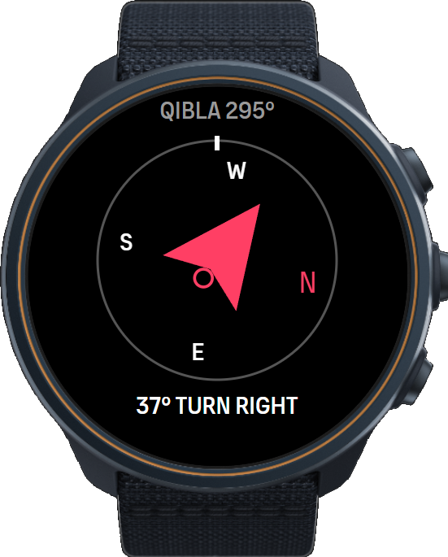 | 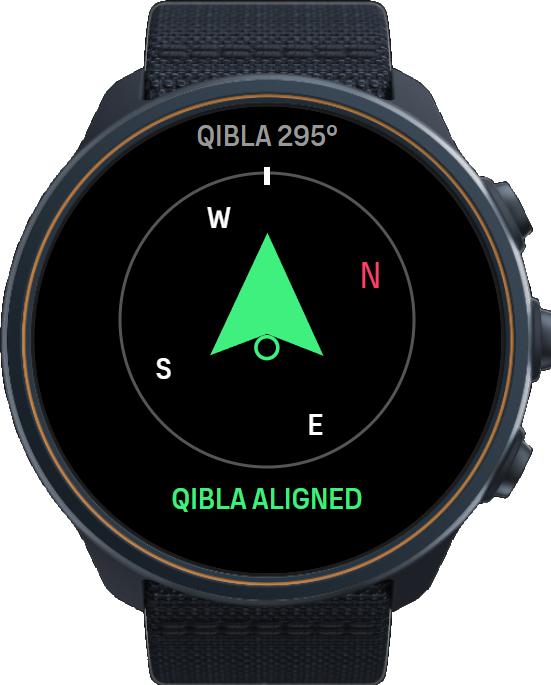 | 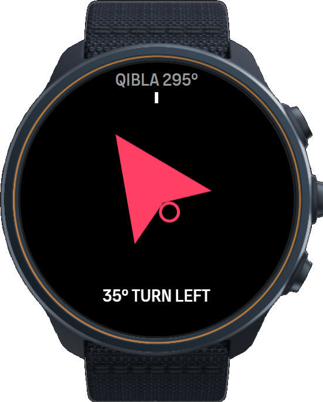 | 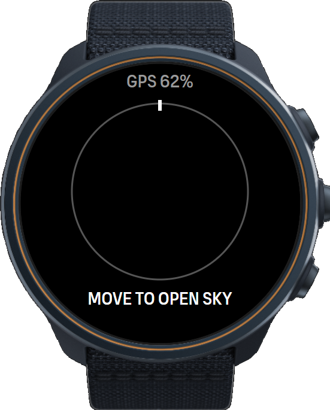 | 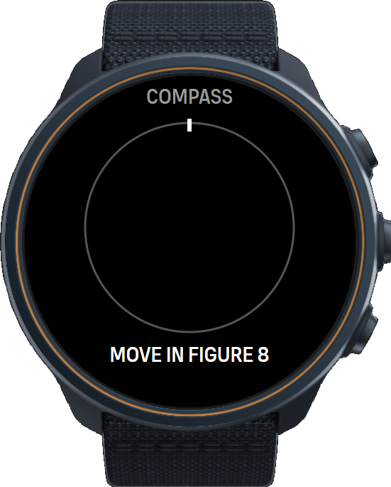 |

## Kaaba reference and your coordinates

The app needs two points:

1. **The Kaaba**, fixed in `main.js` as `KAABA_LATITUDE = 21.422487` and `KAABA_LONGITUDE = 39.826206`.
2. **You**, read live from the watch GPS (`/Fusion/Location/GeoCoordinates`).

From these it calculates the great-circle initial bearing, measured clockwise from north. From Indonesia the Qibla is **not due west (270°)** but west-north-west, about **291°–296°** depending on the city.

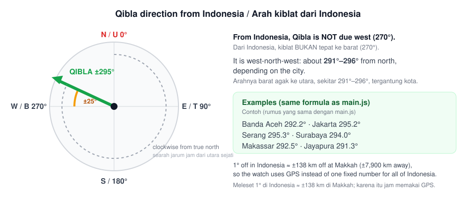

To check the number on the watch against your own location:

1. Get your coordinates. In Google Maps, long-press your location (right-click on desktop). The coordinates appear in the search box, e.g. `-6.120100, 106.150300`. A minus latitude means south of the equator.
2. Calculate the expected bearing with the same formula the watch uses:

   ```bash
   node tools/hitung-kiblat.js -6.1201 106.1503
   ```

3. Compare it with the top line on the watch (`QIBLA 295°`). They should match within a few tenths of a degree.

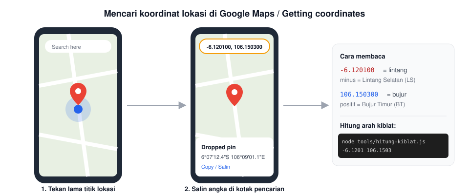

The full Indonesian tutorial (city table, degree/minute/second conversion, and checking against the sun's shadow on the *Rashdul Qiblat* days) is in [docs/KOORDINAT-KIBLAT.md](docs/KOORDINAT-KIBLAT.md).

## Important platform limitations

### The app only runs inside a sport mode

SuuntoPlus apps run only while a sport mode (exercise) is active. There is no watch face or widget. To find Qibla you start a sport mode with Qibla Compass selected, read the direction, then stop. The short activity can be deleted afterward. A custom sport mode named `Kiblat` makes this quicker, but any sport mode works.

### Connecting the watch to a phone removes the app

Qibla Compass is installed directly from a PC with SuuntoPlus Editor (developer install), not from the SuuntoPlus Store. **When the watch connects and syncs with the Suunto mobile app, the SuuntoPlus apps on the watch are reset to the ones in your Suunto account, and Qibla Compass disappears.** Syncing through SuuntoLink on a PC has the same effect.

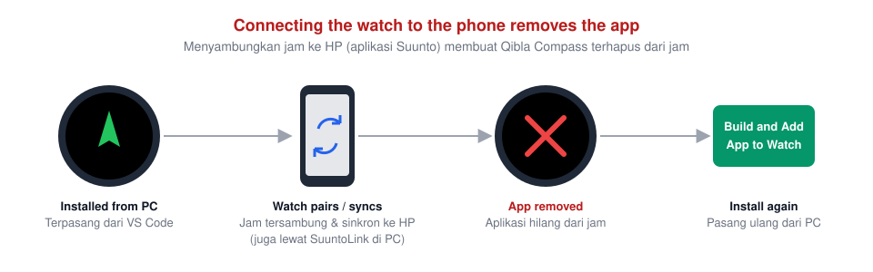

What this means in practice:

- Do everything that needs the phone (creating the `Kiblat` sport mode, settings, firmware updates) **before** installing Qibla Compass.
- After installing, keep the watch **unpaired** from the phone (or the phone's Bluetooth off) for as long as you want to keep the app.
- If the watch syncs with the phone again, install the app again from the PC (step 5 below).
- This limitation only goes away once the app is published in the SuuntoPlus Store.

## Install and test on Race S

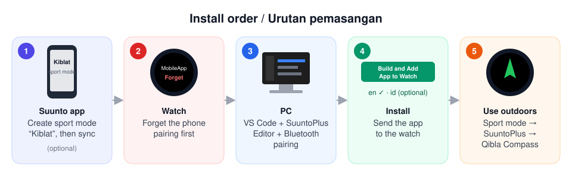

### Requirements

- A Windows 10/11 or macOS computer with **Visual Studio Code**.
- The official **SuuntoPlus Editor** extension.
- **Bluetooth Low Energy (BLE) on the computer: Bluetooth 4.0 or newer.** The Race S charging cable carries no data, so Bluetooth is the only way to install. Old Bluetooth 2.0/2.1 adapters (such as old CSR "BT 2.0" dongles) do not support BLE and will not find the watch. Tested with a USB **Bluetooth 5.4** adapter. A laptop's built-in Bluetooth works if it is 4.0 or newer.
- A charged Race S.

Checking the Bluetooth version on Windows: **Device Manager → Bluetooth → your adapter → Properties → Advanced → Firmware / LMP**. LMP 6 = Bluetooth 4.0, 7 = 4.1, 8 = 4.2, 9 = 5.0, 10 = 5.1, 11 = 5.2, 12 = 5.3, 13 = 5.4. LMP 5 or lower is too old.

### Steps

**1. (Optional) Create the sport mode on the phone first.** In the Suunto app, create a custom sport mode named `Kiblat` and sync it to the watch. Do it now, because the phone has to stay disconnected later.

**2. Forget the phone on the watch.** **Settings → Connectivity → Paired devices → MobileApp → Forget**.

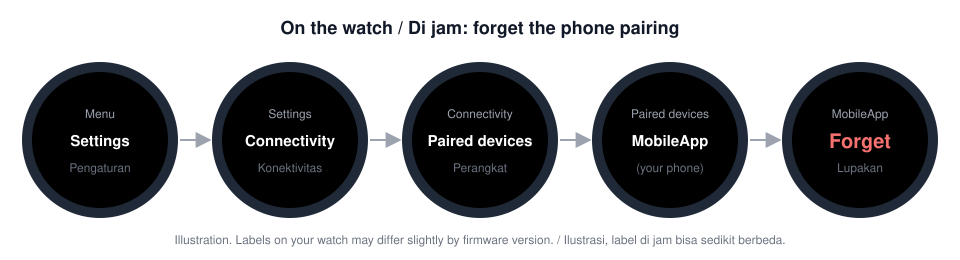

**3. Install VS Code and SuuntoPlus Editor, then open this folder.** Extensions view (`Ctrl+Shift+X`) → search `SuuntoPlus Editor` → Install. Then **File → Open Folder…** and choose this project folder. Close SuuntoLink if it is running.

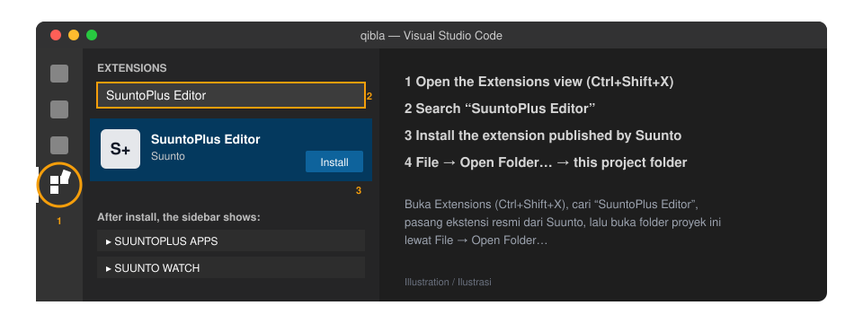

**4. Pair the watch with the computer over Bluetooth, in this order:**

1. Remove the watch from Windows **Bluetooth & devices** if it is already listed.
2. In VS Code, click **Refresh** once in the **SUUNTO WATCH** panel.
3. Pair the watch in Windows (**Add a device**), confirming on the watch if asked.
4. Touch nothing until **Connected Suunto watch** appears. Never click Refresh while it is connecting.

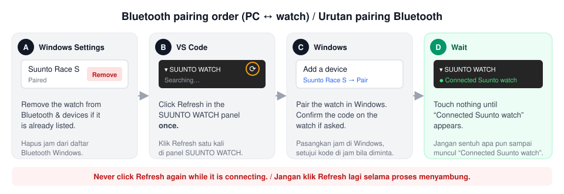

**5. Build and install.** In the **SUUNTOPLUS APPS** panel choose **Build and Add App to Watch**. Pick **English (`en`)**, or **Indonesian (`id`)** if you prefer. The editor chooses the right display package for Race S.

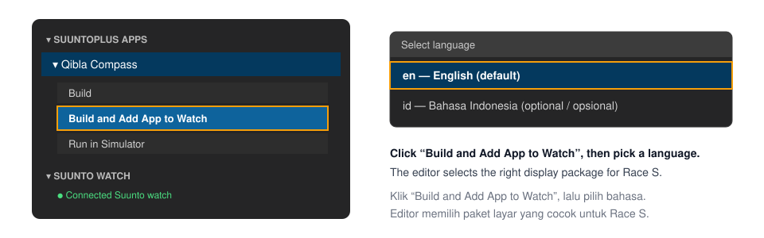

**6. Start it on the watch.** Choose the `Kiblat` sport mode (or any other), open the options before starting, go to **SuuntoPlus**, select **Qibla Compass**, wait for GPS, then start.

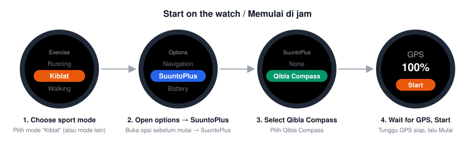

**7. Use it outdoors.** Stand away from cars, metal fences, speakers and reinforced concrete. Hold the watch level. If the screen asks for calibration, move the watch in a figure-eight. Turn until the arrow turns green and the watch vibrates.

**8. Finish.** Stop the exercise. The short activity can be deleted.

The step illustrations are drawings, not screenshots. Labels on your watch or in the editor may differ slightly between versions.

## Files

- `manifest.json` — app metadata and watch resources
- `main.js` — Qibla bearing and alignment logic
- `qibla.html` — Race S watch interface
- `pointer.html` — option 2, arrow-only screen
- `about.html` — About screen
- `id.json`, `en.json` — localization
- `arrow.png` — arrow artwork reference (on the watch the arrow is drawn on canvas in `qibla.html`)
- `qr.png` — QR code for https://about.xhtml.id on the About screen
- `tests/test-qibla.js` — calculation and vibration-latch tests
- `tools/hitung-kiblat.js` — prints the Qibla bearing for any coordinate, using the watch formula
- `docs/` — Indonesian Qibla coordinate guide and step illustrations
- `preview/` — visual previews
- `build/` — local output for `.fea` binaries (not committed; prebuilt files are published under GitHub Releases)

## Accuracy note

The calculation is covered by tests and the app works on the developer's Race S. A compass is still a magnetic sensor: nearby metal, magnets, electronics, reinforced concrete and an uncalibrated compass can move the reading by several degrees. At a new place, compare once with a trusted reference (a mosque's marked Qibla line, or the sun's shadow on a *Rashdul Qiblat* day). Whether `/Fusion/Compass/Heading` is referenced to true or magnetic north is still being confirmed with Suunto; magnetic declination in Indonesia is small but not zero.

## Running the tests

```bash
node tests/test-qibla.js
```

## License

[MIT](LICENSE) © xhtml.id - October 29, 2026
